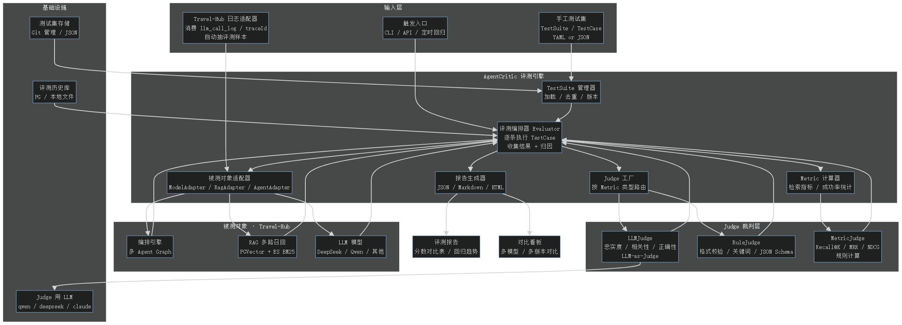

# AgentCritic

> 给 LLM 应用装「裁判」——让 AI 效果从拍脑袋变成可量化、可对比、可回归的工程问题。

**配套项目**：[Agentic-Travel-Hub](https://github.com/MikasaAAAckerman/Agentic-Travel-Hub)（造 Agent 的引擎）→ **AgentCritic**（评 Agent 的裁判）

---

## 为什么做这个项目

AI 应用开发中，「效果好不好」长期停留在**手动测几个 case、凭感觉**的阶段。两个真实痛点：

| # | 痛点 | 现状 |
|---|------|------|
| 1 | 改了 Prompt / 换了模型，效果变好还是变差？ | 没有客观答案 |
| 2 | RAG 命中质量、工具调用准确率、多步任务成功率 | 拿不出数字 |

**AgentCritic 的目标：让 LLM 应用的效果「可量化、可对比、可回归」。**

- **可量化** —— 固定测试集 + 多维打分（LLM 主观分 + 规则客观分 + 指标计算分）
- **可对比** —— 同一测试集跑多版本 / 多模型，出对比报告
- **可回归** —— 评测历史落库，改动后重跑，看趋势涨跌

## 核心特性

- 🔀 **中台级定位**：评测对象不限于 Travel-Hub，任何 LLM 应用（SillyTavern 等）都能评
- 📋 **数据契约先行**：四层标准表（会话 / 调用 / 工具 / 反馈），所有生产方按统一格式入库
- 🧑‍⚖️ **三态 Judge**：LLMJudge（主观质量）/ RuleJudge（客观规则）/ MetricJudge（Recall@K、MRR、NDCG）
- 🔗 **与自研引擎闭环**：评测数据直接消费 Travel-Hub 的 llm_call_log / traceId
- 🐢 **零生产方侵入**：Pull + Adapter（ETL）方式采集，生产方不用改一行代码
- 🇨🇳 **中文场景优先**：中文测试集 + 中文 Judge 打分

## 架构



详细设计见 [设计文档](设计文档/)（架构设计思路 / 全量化指标）。

## 快速开始（M1 规划）

> 当前处于设计阶段，以下为 M1 目标形态。

### 环境要求

- JDK 21
- Maven
- MySQL 8（库名 `agentic-critic`）
- 可访问的 Travel-Hub 数据库（PG，提供 llm_call_log 数据源）

### 配置

`application.yml` 中配置：

```yaml
# 评测数据源：读 Travel-Hub 的 llm_call_log
travel-hub:
  datasource:
    url: jdbc:postgresql://localhost:5432/travel_hub
    username: travel
    password: travel123

# 多模型渠道（复用 Travel-Hub 的 ChatClient 多渠道模式）
spring:
  ai:
    judge:      # Judge 专用模型（与被测模型不同 + 低温）
      model: ...
    target:     # 被测模型
      model: ...
```

### 跑一次评测

```bash
mvn spring-boot:run   # 或执行 main 方法
# Ingestor 增量拉取 llm_call_log → 清洗入库 → Evaluator 打分 → 生成 Markdown 报告
```

## 目录结构（规划）

```
agent-critic
  ├── src/main/java/com/agent/critic
  │     ├── ingestor     # 数据采集（TravelHubIngestor / 清洗）
  │     ├── evaluator    # 评测编排
  │     ├── judge        # 三态 Judge（LLM / Rule / Metric）
  │     ├── metric       # 指标计算（Recall@K / MRR / NDCG）
  │     ├── report       # 报告生成
  │     ├── repository   # 标准表 DAO
  │     └── domain       # 实体 / DTO
  ├── 设计文档/           # 架构图 / 设计流程 / 选型思考
  └── README.md
```

## 路线图

```
M1：四层标准表 + TravelHubIngestor + LLMJudge + MetricJudge → Markdown 报告
M2：Agent 评测（成功率 + 失败归因）+ RuleJudge
M3：评分稳定性（多采样 / 低温 / swap）+ 回归测试 + 评测历史对比
M4：模型对比评测（同测试集多模型）+ HTML 看板
```

## 技术栈

| 项 | 选型 |
|----|------|
| 语言 / 框架 | JDK 21 + Spring Boot + Spring AI & Spring AI Alibaba |
| 数据库 | MySQL 8 |
| 评测模型 | 可插拔（与被测模型不同的更强模型，OpenAI 兼容 API） |

## License

MIT
